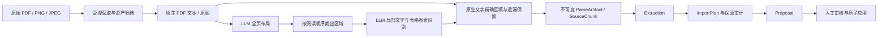

# MinerU 借鉴评估与实施方案

评估日期：2026-10-27。上游源码固定到
[`b7f3dd0c5f6e6d66a298239ffd02b328b873918e`](https://github.com/opendatalab/MinerU/tree/b7f3dd0c5f6e6d66a298239ffd02b328b873918e)，
本仓库比较基线为 `a94043f`。

## 结论

融入 MinerU 的布局与内容识别分离设计，改造解析层；继续采用 Anby 的领域服务、
不可变证据、导入计划和人工审核架构。PDF、PNG、JPEG 的模型处理只使用账号配置的
多模态 LLM。原生文本读取、图片裁剪、JSON 校验与证据匹配是确定性处理，不引入
embedding、向量数据库、独立 OCR/布局/表格小模型或 MinerU 运行时依赖。

MinerU 的目标是把文档转换为可消费的结构化内容；Anby 还要处理事实归属、来源证据、
跨页面规划、并发修改与治理事务。上游没有取代这些领域边界的依据。

## 证据与比较

以下上游实现事实由固定版本的官方源码与文档核对，属于同一项目的一手证据
`[SINGLE-SOURCE]`。论文支持两阶段设计的动机，但其训练模型的性能不能直接外推到
我们使用的通用 LLM；本次没有声称 Anby 的识别准确率或成本已经优于旧实现。

| 比较维度 | MinerU 固定版本 | Anby 改造前 | 决策 |
|---|---|---|---|
| 布局与识别 | PDF 窗口区分布局、原生文本、局部视觉识别；高投入路径调用 `batch_two_step_extract` [1] | 每页一张最长边 2000 像素图片，单次输出全部正文与视觉元素 | LLM 先输出区域和阅读顺序，再按区域识别 |
| 细小文字与密集表格 | 两阶段模型在缩小页图上定位，在原始分辨率裁图上识别 [2] | 整页缩小后识别，局部细节无法恢复 | PDF 保留最长边 4000 像素渲染，布局图缩至 1600，局部裁图用于识别 |
| 统一中间结果 | ModelJson → MiddleJson → 多种渲染输出，保留源页号和几何 [3][4] | ParseArtifact/SourceChunk 已统一 text/table/chart/figure/page | 延用现有制品，增加阅读顺序、两阶段 Prompt 身份和原图坐标 |
| 原生文字与视觉文字 | 原生 PDF 文字与视觉结构分开处理 [1] | 原生全文保持精确，视觉文本被丢弃 | 视觉区域文字仅在能逐字或仅空白差异回填到原生全文时使用；未匹配原文保留为补充分片 |
| 独立图片 | Flash/Basic/Standard 等路径可使用 OCR、小模型与 VLM [5] | Tesseract OCR，只保留行级文字 | 图片与扫描 PDF 共用 LLM 布局和区域识别 |
| 大文档与故障 | 分窗、异步取消、资源回收 [1] | 页并发 3、500 页上限、Parse 原子失败与重试恢复点 | 保持页并发上限，区域串行，任何必需区域失败即整次解析失败 |
| 稳定定位 | 页、块和字符 cursor [6] | SourceVersion/Chunk UUID、页码、字符范围、图片区域 | 保持稳定 UUID；阅读顺序使用服务端数组位置，不信任模型生成 ID |
| 文档后处理 | 确定性处理后可选 LLM 标题与跨页表格增强 [4] | 确定性计划合并、证据化 fidelity 审计 | 延用已有合并和审计；不把跨页表格猜测写回不可变来源 |
| 依赖与许可 | 包含 DocVortex、ONNX、OCR、VLM 引擎；许可有附加条款 [5][7] | Go Worker + 私有 Semantic Kernel + Poppler | 只实现设计思想，不复制源码或引入包 |

## 实施后的流程

1. **布局契约**：新的 `document-page-layout-v1` Prompt 只返回
   `kind/title/section_path/region`，数组即阅读顺序。区域使用 0–1000 坐标，必须在页内，
   最多 200 个区域。布局输出不承担长文本转写，不让模型计算数据库 UUID、字符范围。
2. **局部识别契约**：新的 `document-region-analysis-v1` Prompt 接收一张区域裁图和
   元素类型，只返回文字、摘要、结构化数据、置信度与警告。不提供整页原生全文，
   避免其他栏文字污染裁图转写，并减少重复输入；原生字符纠正由服务端精确回填完成。
   页号、类型、区域、阅读顺序由 Worker 绑定，不能由第二阶段改写。
3. **图像处理**：PDF 页渲染最长边 4000，布局请求最长边 1600，局部识别最长边
   2000；PNG/JPEG 保持原始像素坐标，布局和裁图单独缩放。输入先检查 4000 万像素上限，
   所有发送图片限制 16 MiB，不放大低分辨率原图。图片只在当前页调用期间保留。
4. **原生文本保真**：按区域文字匹配原生页文本，仅接受字符完全相同或纯空白差异，
   回填原始子串。重复出现的文字不猜测位置；保留原生补充分片。未被任何可信区域覆盖的
   原文继续固化，不能因布局遗漏或 LLM 转写错误丢失。有文本层时无法匹配的视觉正文
   不冒充原生文字；扫描页与图片的文字标记为视觉转写。
5. **制品身份与审计**：解析元数据同时记录布局和识别 Prompt 的实际版本，两者
   均参与 parser fingerprint。同次解析不得混用 Provider、模型或各阶段 Prompt 版本。
   所有调用沿用 Gateway/Kernel 的 Schema 校验、重试与用量审计。
6. **兼容与交付**：新解析器版本只生成新的 SourceVersion，不改写历史制品。
   不改数据库、OpenAPI、Typed Block AST 或发布事务。保留旧页分析契约用于现有
   模型连通性测试和历史定义；新契约加入副本漂移门禁。Worker 移除 Tesseract 依赖。

## 验收范围与限制

核心验证使用真实 Poppler 处理 PDF；模型边界使用确定性测试响应验证布局、裁图、
阅读顺序、Unicode 原文回填、遗漏保留、越界拒绝、Prompt 一致性和整次失败行为。
图片走真实解码、裁剪和编码路径。再运行 Go、AI Kernel 测试及 `make check`。
测试模型响应只验证协议和编排，不作为真实识别准确率数据。

| 验证命令 | 最终结果 |
|---|---|
| `go test -count=1 ./internal/importer ./internal/ai ./cmd/api ./cmd/worker`（backend） | 通过，包含真实 Poppler 与图片编解码/裁剪 |
| `make test-ai` | 9 项通过；既有 Starlette 依赖弃用警告 |
| `make check` | Go 格式/vet、TS、ESLint、Go/Web 构建、契约、Web API 覆盖、迁移及部署静态检查通过 |
| Docker Compose / 镜像校验 | 本地 Docker 不可用，未执行 |
| `go test -count=1 ./...`（backend） | 解析与其他已输出包通过；CLI 两个包因下述既有测试漂移失败 |
| `git diff --check` | 通过 |

没有新的模型训练或真实供应商识别基准。两阶段调用数为每页一次布局加每区域一次识别，
密集文档的请求数可能增加；沿用账号超时、Gateway 限流和 ImportJob 总超时。
复杂公式仍通过可核验的文字/表格表达，跨页合并仍由 ImportPlan 负责。
生产部署后应使用同一账号模型比较双栏正文、密集表格、扫描件与图表的遗漏、引用正确性、
调用量和耗时。本次实施与本地验证不代表已经部署或完成生产识别验收。

## 实现对应

| 文件 | 改动 |
|---|---|
| `backend/internal/importer/vision_regions.go` | 两阶段 LLM、Schema 独立校验、原图裁剪、原文回填和图片 Adapter |
| `backend/internal/importer/pdf_vision.go` | 高分辨率页渲染、区域流程接入、原生余文保留与跨页模型/Prompt 一致性 |
| `backend/internal/importer/document_parser.go` | 图片路由、两阶段身份进入解析元数据与 fingerprint |
| `backend/internal/importer/pdf_runtime.go` | 保留 PDF 子进程边界；原 `ocr.go` 中 Tesseract 路径移除 |
| `backend/cmd/worker/import_runtime.go` | 注册布局和区域识别两个版本化 Prompt |
| `contracts/schemas/document-parsing/v1/` 与 importer 内嵌副本 | 新布局和局部识别契约 |
| `scripts/check-contracts.sh`、`Dockerfile` | 新 Schema 漂移门禁、移除 OCR 镜像依赖 |
| `backend/internal/importer/vision_regions_test.go`、`parser_test.go` | 真实渲染/裁剪、区域次序、原文保真与失败边界测试 |
| ADR-0023、当前实现状态、Importer/AI README、OutstandingIssues | 同步架构选择、现状与生产验收范围 |

全量 Go 回归发现既有 CLI 测试漂移：`clicontract/contract_test.go`、
`wikicli/all_operations_test.go`、`wikicli/app_test.go` 仍断言 167 个 operation，而
当前契约为 178 个；授权状态测试的 Session 响应缺少当前 Schema 必填的 `wikis`。
这些测试、CLI 实现和 OpenAPI 均无本次 diff；该问题不作为新解析器验证通过的依据。

资源交接：本次根 Dockerfile 编辑已结束。后续由维护者安排
`DOC-PARSE-ACCEPT`（真实供应商的解析质量与成本比较）和
`CLI-CONTRACT-TESTS`（现有 CLI 测试与当前契约同步）。

## 来源

1. [PDF 分窗与视觉编排源码](https://github.com/opendatalab/MinerU/blob/b7f3dd0c5f6e6d66a298239ffd02b328b873918e/mineru/backend/analysis/pdf/window.py)
2. [MinerU2.5 原论文，Two-Stage Parsing Strategy](https://arxiv.org/html/2509.22186v1#S3.SS2)
3. [输出格式与结果协议](https://github.com/opendatalab/MinerU/blob/b7f3dd0c5f6e6d66a298239ffd02b328b873918e/docs/zh/reference/output_files.md)
4. [确定性文档后处理](https://github.com/opendatalab/MinerU/blob/b7f3dd0c5f6e6d66a298239ffd02b328b873918e/mineru/backend/postprocess/document.py)、
   [LLM 标题与表格增强](https://github.com/opendatalab/MinerU/blob/b7f3dd0c5f6e6d66a298239ffd02b328b873918e/mineru/backend/postprocess/llm_aided.py)
5. [解析档位](https://github.com/opendatalab/MinerU/blob/b7f3dd0c5f6e6d66a298239ffd02b328b873918e/docs/zh/usage/tiers.md)、
   [运行依赖](https://github.com/opendatalab/MinerU/blob/b7f3dd0c5f6e6d66a298239ffd02b328b873918e/pyproject.toml)
6. [稳定内容定位](https://github.com/opendatalab/MinerU/blob/b7f3dd0c5f6e6d66a298239ffd02b328b873918e/mineru/doclib/locators.py)
7. [MinerU 许可](https://github.com/opendatalab/MinerU/blob/b7f3dd0c5f6e6d66a298239ffd02b328b873918e/LICENSE.md)
